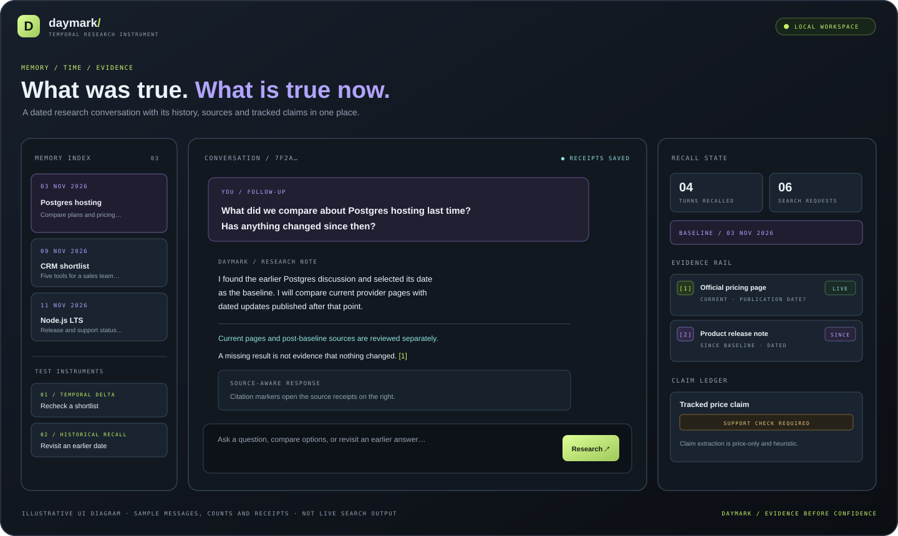

# Daymark

  <strong>What was true. What is true now. What changed in between.</strong>

  
  
  
  
  

**Daymark is a temporal research agent.** It remembers what you asked, when you asked it, what it answered and which web sources supported that answer. When you return later, Daymark can recover the old research and check whether the evidence still holds.

Most chat tools answer **“What can I find now?”** Daymark also asks **“What did we believe then, why did we believe it, and what can we verify now?”**

  

<em>Animated four-stage product workflow. The Postgres example and receipt cards are illustrative; this animation does not show live provider results.</em>

**The central design constraint:** the model gets exactly one callable tool, **web_search**. Date handling, historical recall, query replay, persistence and claim bookkeeping stay in application code.

---

## Start here

| Want to… | Go to |
|---|---|
| Understand the product | [How it works](#how-it-works) |
| Run it locally | [Quick start](#quick-start) |
| Try a realistic task | [Try the workflow](#try-the-workflow) |
| Understand the internals | [Architecture](#architecture) · [DESIGN.md](DESIGN.md) |
| Check what is tested | [Tests and evaluation](#tests-and-evaluation) · [EVALUATION.md](EVALUATION.md) |
| Review security boundaries | [Limitations and security](#limitations-and-security) · [SECURITY.md](SECURITY.md) |

## The product at a glance

Daymark uses a three-panel workspace. The left side is the memory index and example prompts; the centre is the conversation; the right side shows recall state, numbered source receipts and the claim ledger.

  

<em>Illustrative UI composition based on the real interface. Messages, counts and receipt cards in this image are sample content, not live research output.</em>

### Why this is useful

A normal chat answer can become difficult to audit a week later. You may remember the conclusion but not the exact question, date, plan or region compared, or the source that supported it.

Daymark is designed for work such as:

- Rechecking a shortlist of products or providers after a few days.
- Finding an earlier decision and checking whether its assumptions still hold.
- Comparing current product pages with dated announcements published since the original research.
- Preserving uncertainty when sources are missing, undated or inconclusive.

## How it works

A turn follows seven stages:

1. **Capture** — save the user message with a timestamp and conversation ID.
2. **Resolve** — interpret supported date phrases in the configured timezone.
3. **Recall** — search saved turns by date and topic using SQLite and FTS5.
4. **Choose a baseline** — use a historical turn only when the date/topic match is sufficiently clear.
5. **Replay** — reuse the old source-specific and original queries in two search lanes.
6. **Research** — let the model call the single web_search tool when more research is needed.
7. **Audit and preserve** — validate citation IDs, check recognizable price claims, and save the answer with source receipts.

### The two search lanes

| Lane | What it checks | Why both matter |
|---|---|---|
| **Current** | The page as it exists now. | A pricing page may be edited in place without a new announcement. |
| **Since baseline** | Pages with a publication date on or after the historical date. | Release notes and announcements can help establish when a change was published. |

A difference on a current page does **not** automatically prove when that change happened. If the source has no trustworthy publication date, Daymark should say that the timing is unknown.

### The safe-stop behaviour

If a historical question needs a baseline but no matching record exists, Daymark says that it has no saved history. If a weekday phrase could refer to more than one date and the topic does not identify one clearly, it asks for clarification.

Those paths return before the model and search provider are called. **“No record found” is not the same as “no change found.”**

## Quick start

### Requirements

- **Node.js 22.5 or newer.** The project uses Node's built-in node:sqlite module.
- An OpenAI-compatible chat-completions endpoint with tool/function calling.
- A Tavily or Exa search API key.

### 1. Clone and install

~~~bash
git clone https://github.com/Prakash-codeMaker/daymark-minimi-challenge.git
cd daymark-minimi-challenge
npm ci
~~~

### 2. Create your environment file

macOS / Linux:

~~~bash
cp .env.example .env
~~~

Windows PowerShell:

~~~powershell
Copy-Item .env.example .env
~~~

Open .env and add your credentials:

~~~dotenv
# Required: chat model with tool-calling support
OPENAI_API_KEY=your_key
OPENAI_BASE_URL=https://api.openai.com/v1
OPENAI_MODEL=gpt-4.1-mini

# Required: choose at least one search provider
TAVILY_API_KEY=your_tavily_key
# EXA_API_KEY=your_exa_key
SEARCH_PROVIDER=auto

# Optional settings
PORT=3000
TIMEZONE=Asia/Kolkata
DATABASE_PATH=./data/daymark.sqlite
MAX_TOOL_ROUNDS=3
MAX_SEARCH_RESULTS=5
~~~

With SEARCH_PROVIDER=auto, Exa is selected when an Exa key is present; otherwise Tavily is used. You can explicitly set the value to exa or tavily.

### 3. Start the app

~~~bash
npm run dev
~~~

Open **http://127.0.0.1:3000** in your browser.

The status indicator reports whether the model and search credentials are configured. Conversation turns, source receipts and claims are persisted in the local SQLite database. The browser restores the active conversation using its saved conversation ID.

### 4. Check that the app is ready

Open this local endpoint:

~~~text
http://127.0.0.1:3000/api/health
~~~

It reports whether the model and search configuration are present, along with the Node.js version. A ready status means credentials are configured; it does not guarantee that an external provider request will succeed.

## Try the workflow

The app includes a four-step guided tour. Open **Play walkthrough** to understand the flow before sending your own research question.

### Step A — Create a historical baseline

Start with a real question. For example:

~~~text
Compare PostgreSQL hosting options for my side project.
Focus on pricing, free-tier limits, and major product changes.
Cite the sources you use.
~~~

Let the first request finish. Daymark saves the user turn, answer and returned source receipts in the local database.

### Step B — Return to the same topic later

After some time has passed, ask:

~~~text
What did we compare about PostgreSQL hosting last time?
Has anything changed in pricing, limits, or major product updates
since then? Recheck the options we discussed and show the sources.
~~~

Daymark attempts to recover the earlier discussion, select its date as the baseline, replay the old research and compare the evidence it can retrieve now.

### Step C — Inspect the result

Use the right-hand panel to understand what happened:

| UI area | What to look for |
|---|---|
| **Recall state** | Which historical turns were retrieved, how many provider requests ran, and which baseline date was selected. |
| **Evidence rail** | Numbered sources, current/since labels, publication dates when supplied, and stored excerpts. |
| **Claim ledger** | Recognizable price claims, their support state and any like-for-like comparison with an earlier confirmed claim. |

The first question needs to run successfully before a later question can be compared with it. If relevant history is missing or ambiguous, the correct result is an honest explanation—not a fabricated memory.

### More prompts to try

**Explicit-date recall**

~~~text
What did I ask you on 3 November 2026? Is your answer
still supported by current evidence?
~~~

**Ambiguous weekday**

~~~text
Last Tuesday I asked you about Postgres hosting.
Has pricing changed since then?
~~~

The second prompt is deliberately useful for testing ambiguity. If Daymark cannot identify one historical date from the topic and saved context, it should ask you to clarify.

## Architecture

The browser talks to a small Node.js HTTP server. The agent harness owns the control flow; the model does not own memory or date calculations.

~~~mermaid
flowchart TD
    U[User message] --> API[POST /api/chat]
    API --> DATE[Resolve date in configured timezone]
    DATE --> MEM[SQLite date index + FTS5 topic recall]
    MEM --> BASE{Safe historical baseline?}
    BASE -->|Missing or ambiguous| SAFE[Explain or ask for clarification]
    BASE -->|Usable| REPLAY[Load prior query and source receipts]
    REPLAY --> CUR[Current-page search]
    REPLAY --> SINCE[Search published since baseline]
    CUR --> REG[Register and deduplicate receipts]
    SINCE --> REG
    REG --> MODEL[Chat-completions model]
    MODEL --> TOOL{Call web_search?}
    TOOL -->|Yes| SEARCH[Validate and run bounded search]
    SEARCH --> MODEL
    TOOL -->|No| ANSWER[Final answer with citation IDs]
    ANSWER --> AUDIT[Validate citations and check price claims]
    AUDIT --> DB[Save turn, sources, hashes and claims]
    SAFE --> DB
~~~

### One tool, bounded execution

The model receives one function definition: web_search(query, since?). The application validates the tool name and arguments, applies a bounded tool loop and limits search fan-out. The model cannot directly call the database, set dates or write claims.

This keeps the control flow inspectable:

- Date parsing and baseline selection are ordinary JavaScript functions.
- Historical recall uses SQLite indexes and FTS5, not another model tool.
- Previous searches are replayed rather than reconstructed from scratch.
- Search results are treated as untrusted evidence, never as instructions.
- Search calls, parallel fan-out and model/tool rounds are bounded by the agent harness.

### Temporal memory

The date resolver supports common expressions such as today, yesterday, N days ago, N weeks ago, weekday references, last Tuesday, and explicit dates such as 2026-11-03.

A phrase such as last Tuesday can have more than one plausible interpretation. Daymark keeps those possibilities separate. A topic match may identify one candidate; otherwise Daymark should ask which date was intended. Date boundaries use TIMEZONE (default: Asia/Kolkata). This is a small deterministic parser, not full natural-language date understanding.

### Evidence receipts

A saved source receipt can include:

- Title and URL.
- Search provider and original query.
- Search mode (current or since-baseline).
- Publication date, if the provider supplied one.
- Retrieval timestamp.
- SHA-256 hash of the URL plus returned excerpt.

A hash helps identify the exact excerpt that was stored. It does not prove that the source itself is trustworthy or that the excerpt supports every nearby sentence.

### The claim ledger

The claim ledger is deliberately narrow. It looks for recognizable **price** sentences and records the subject, amount, currency marker, billing interval and unit where detected, along with the answer sentence and linked source receipts.

A claim is only marked snippet-confirmed when the returned excerpt contains the recognizable subject, amount and detected price dimensions. This is a conservative token check—not semantic entailment or a full-page audit. Unsupported claims remain unverified and cannot supersede a confirmed predecessor. A bare $ is not silently assumed to mean USD.

The conversational answer can distinguish:

- **CHANGED** — evidence supports a different state.
- **STILL SUPPORTED** — available evidence continues to support the earlier statement.
- **CORRECTED** — the old answer needs correction.
- **NEW** — a newly published item is relevant.
- **UNVERIFIABLE** — the evidence is incomplete or inconclusive.

The structured price ledger uses narrower states: baseline, unchanged, changed and unverified.

## HTTP API

All routes are served by the local Node.js server.

| Method | Route | Purpose |
|---|---|---|
| GET | /api/health | Reports model/search configuration and Node.js version. |
| GET | /api/history?conversationId=... | Returns saved turns and their source receipts for a conversation. |
| GET | /api/claims?subject=... | Lists tracked price claims; subject filter is optional. |
| GET | /api/evidence?turnId=123 | Returns evidence and linked claim details for a turn. |
| POST | /api/chat | Runs a new agent turn. |

Example request:

~~~bash
curl -X POST http://127.0.0.1:3000/api/chat \
  -H "content-type: application/json" \
  -d '{"message":"What did we compare about Postgres hosting last time? Has pricing changed?","conversationId":"my-local-thread"}'
~~~

The chat response contains the answer, conversation/turn IDs, recalled memory, numbered source receipts, tracked claims and search metrics. Exact fields and counts depend on the turn and provider responses.

## Tests and evaluation

Run the local checks:

~~~bash
npm test
npm run check
npm run eval
~~~

| Command | What it checks |
|---|---|
| npm test | Date parsing, ambiguous matching, no-history short-circuit, FTS5 retrieval, migrations, tool-loop handling, evidence persistence, conservative price support and search retry behaviour. |
| npm run check | JavaScript syntax checks for the runtime, evaluation scripts and guided tour. |
| npm run eval | Four challenge-shaped offline scenarios plus evidence-ledger checks using a scripted model and mocked search provider. |
| npm run eval:live | Credential-backed run against the configured chat and search providers. Requires keys in .env. |

**Important:** the offline evaluation uses synthetic fixture data and .invalid URLs. It validates architecture, memory retrieval and uncertainty handling; it is **not** a live factual-accuracy benchmark and does not represent Minimi's private evaluation. Live results need manual source review. See [EVALUATION.md](EVALUATION.md) for scenarios and the human-review rubric.

## Project structure

~~~text
.
├── public/
│   ├── index.html       # Responsive chat workspace and evidence panels
│   ├── tour.js          # Four-step in-app guided walkthrough
│   ├── tour.css         # Walkthrough styling and transitions
│   └── assets/          # Provider marks used by the guided example
├── docs/
│   └── images/          # README workflow and workspace visuals
├── src/
│   ├── agent.js         # Memory, baseline, replay, tool loop and claim audit
│   ├── dates.js         # Timezone-aware date parsing
│   ├── db.js            # SQLite schema, FTS5 and persistence
│   ├── search.js        # Tavily/Exa adapters and retry logic
│   ├── config.js        # Environment configuration
│   └── server.js        # HTTP API and static-file server
├── test/                # Deterministic automated tests
├── eval/                # Offline/live scenario runners and reports
├── DESIGN.md            # Architecture decisions and design thesis
├── EVALUATION.md        # Evaluation scenarios and review rubric
└── SECURITY.md          # Local-MVP security boundary
~~~

## Configuration reference

| Variable | Default | Purpose |
|---|---|---|
| OPENAI_API_KEY | — | API key for the chat-completions model. |
| OPENAI_BASE_URL | https://api.openai.com/v1 | OpenAI-compatible API base URL. |
| OPENAI_MODEL | gpt-4.1-mini | Model name; must support tool/function calling. |
| TAVILY_API_KEY | — | Tavily search credentials. |
| EXA_API_KEY | — | Optional Exa search credentials. |
| SEARCH_PROVIDER | auto | auto, tavily or exa. |
| PORT | 3000 | Local HTTP server port. |
| TIMEZONE | Asia/Kolkata | Timezone for date interpretation and day boundaries. |
| DATABASE_PATH | ./data/daymark.sqlite | Local SQLite database path. |
| MAX_TOOL_ROUNDS | 3 | Maximum model/tool rounds, clamped by the config loader. |
| MAX_SEARCH_RESULTS | 5 | Results requested per provider call, clamped by the config loader. |

## Limitations and security

Daymark is a local challenge MVP, not a hardened multi-user service.

- The server binds to 127.0.0.1 by default. **Do not expose it to an untrusted network.**
- There is no authentication, account isolation, CSRF protection, rate limiting or production deployment boundary.
- The current claim extractor is price-only and heuristic. It is not a general-purpose fact ledger or semantic citation checker.
- Search providers return excerpts, not guaranteed full-page snapshots. An in-place page edit may not reveal when the edit happened.
- The UI is non-streaming. The date parser supports a limited set of phrases.
- Local history is stored in SQLite, but messages sent to the configured model and search providers leave the local machine as part of those API requests.
- Keep .env, logs and SQLite files out of Git. Review [SECURITY.md](SECURITY.md) before changing the deployment boundary.

## Design notes and next steps

The project deliberately avoids adding a vector database, unbounded search loop or multi-agent graph before there is evidence those additions improve the task. Useful next engineering steps include streaming/cancellation, full-page evidence snapshots, exact claim quote spans, semantic citation checks, per-user isolation and a held-out human-labelled benchmark.

For more detail:

- [DESIGN.md](DESIGN.md) — architecture thesis, runtime sequence and trade-offs.
- [EVALUATION.md](EVALUATION.md) — scenarios, offline/live distinction and human-review rubric.
- [SECURITY.md](SECURITY.md) — current security boundaries and production hardening needs.
- [COMPETITOR_REVIEW.md](COMPETITOR_REVIEW.md) — product and architecture comparison notes.

---

<strong>Daymark — evidence before confidence.</strong>
