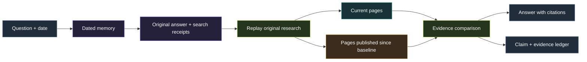
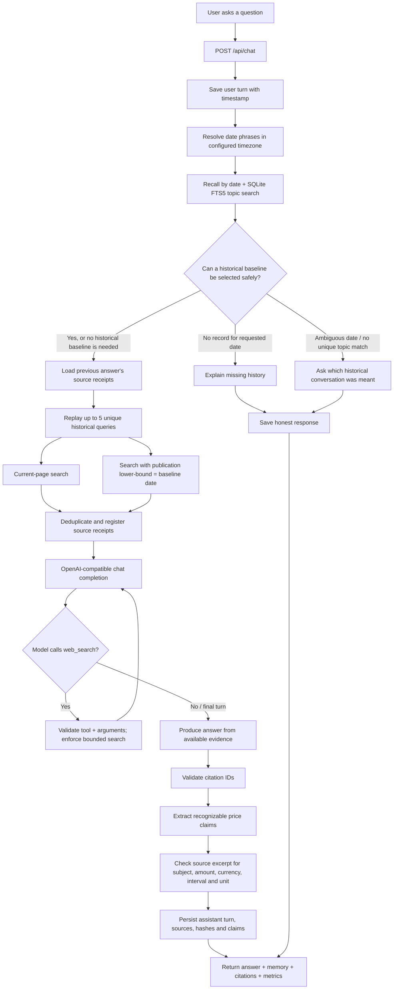
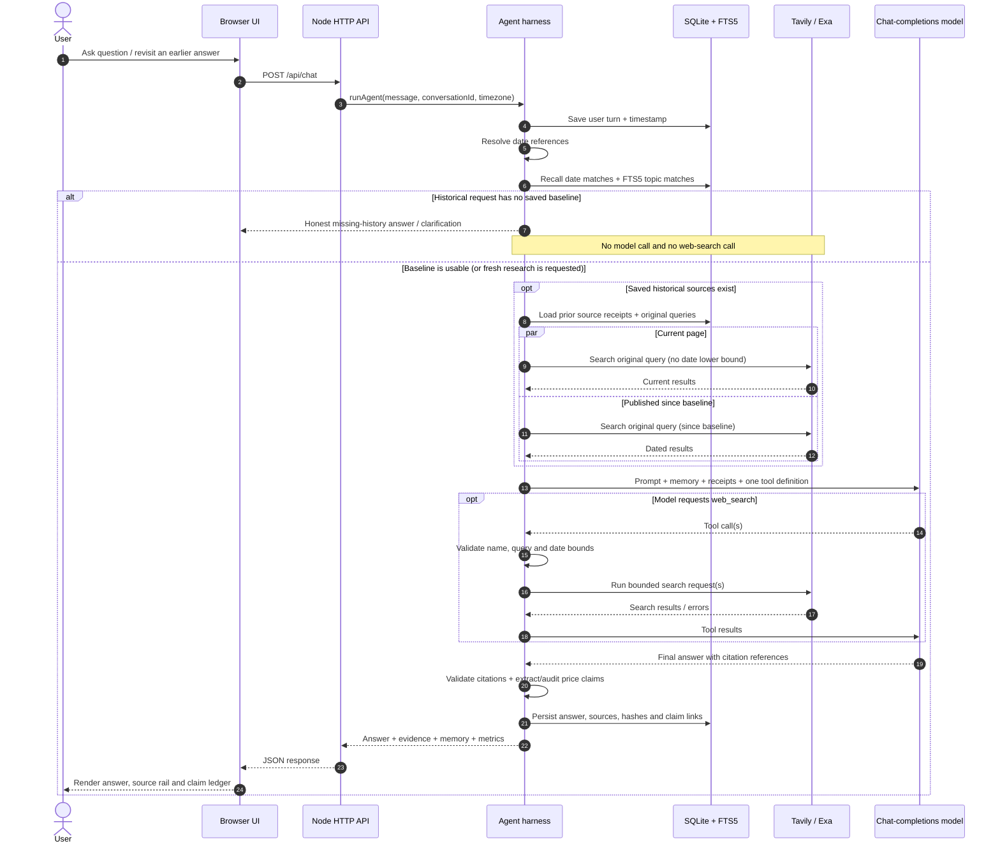
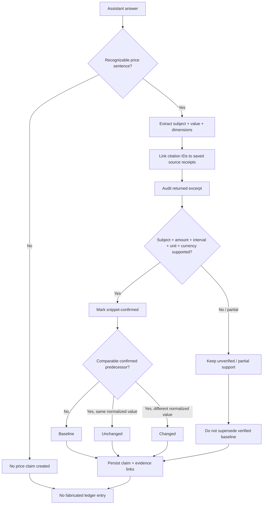
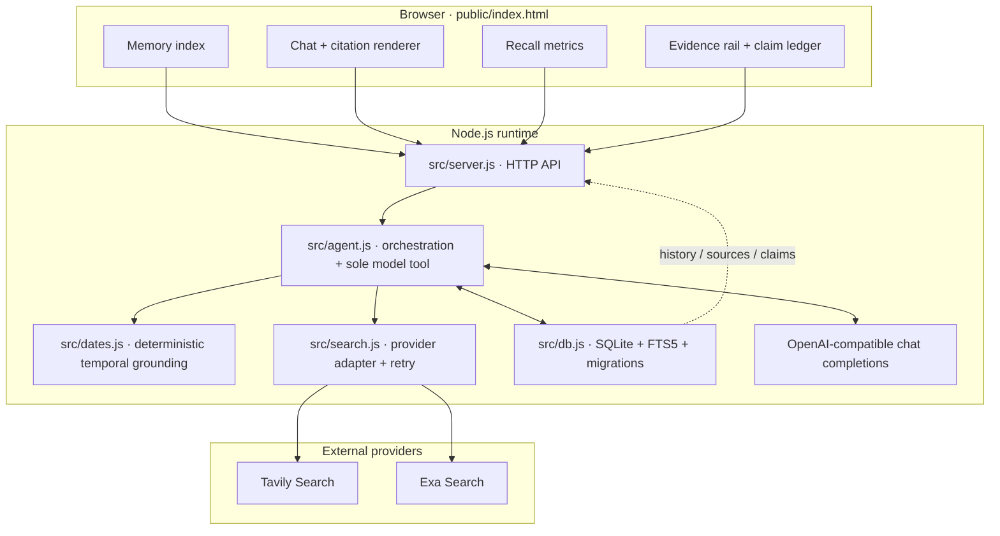
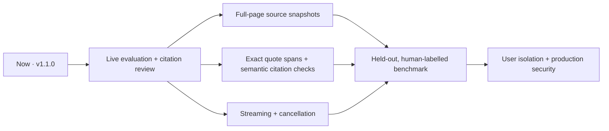

# DAYMARK
### What was true. What is true now. And what evidence changed in between.

[](https://github.com/Prakash-codeMaker/daymark-minimi-challenge/actions/workflows/ci.yml)


**Daymark is a temporal research agent.** It remembers the question, the date, the answer and the original web evidence—then replays that research when you ask whether the answer is still true.

It is built around one deliberate constraint: **the model gets exactly one callable tool, `web_search`.** Dates, recall, replay planning, evidence storage and claim bookkeeping stay in deterministic application code.

> Most search tools answer: “What can I find now?”
>
> Daymark also asks: “What did we believe then, why did we believe it, and what can we verify now?”

[Explore the source](https://github.com/Prakash-codeMaker/daymark-minimi-challenge) · [Read the design](DESIGN.md) · [Evaluation plan](EVALUATION.md) · [Security notes](SECURITY.md)

---

## The idea in one picture

A normal chat response is easy to lose: the question, date and sources become scattered across a long thread. Daymark keeps those pieces connected so that a future answer can be checked against its historical baseline.



**The differentiator is temporal evidence replay.** Daymark does not only invent a fresh search query for an old topic. When the prior answer has saved source receipts, it reuses the source titles/domains and original queries. It checks those queries in two lanes:

- **Current lane:** search the page as it exists now. This can reveal a pricing page edited in place.
- **Since lane:** search for pages published on or after the historical baseline. This can reveal dated launches, announcements and changes.

A current-page difference without a trustworthy publication date is not automatically proof of *when* a change happened. Daymark is designed to preserve that uncertainty.

## See the whole turn, end to end

This is the actual request path through the application—not a conceptual multi-agent diagram. The orchestration is ordinary Node.js code, with one model-callable tool.



### A closer look: the runtime sequence



---

## What happens when you ask a question?

| Stage | What Daymark does | Why it matters |
|---|---|---|
| 1. Capture | Stores the user turn with an ISO timestamp and conversation ID. | The answer can be tied to the time it was given. |
| 2. Resolve | Interprets supported date phrases in the configured timezone. | “Last Tuesday” is not silently treated as an exact date. |
| 3. Recall | Queries SQLite date indexes and FTS5 topic search. | The previous discussion is retrieved before asking the model. |
| 4. Establish baseline | Selects a unique date/topic match when possible. | An unrelated conversation is not used as the comparison point. |
| 5. Replay | Reuses prior source-specific and original queries in current and since-baseline modes. | Both edited pages and dated announcements can be discovered. |
| 6. Research | Gives the model one tool: `web_search`. | Tool use is bounded and inspectable. |
| 7. Audit | Validates citation IDs; extracts and checks recognizable price claims. | A citation pointer is not mistaken for proof. |
| 8. Preserve | Saves the answer, source receipts, hashes and claim/source links. | The next re-check has a traceable baseline. |

### Temporal memory is deterministic

The date resolver in `src/dates.js` supports common forms:

- `today`, `yesterday`, `day before yesterday`
- `N days ago` and `N weeks ago`
- Weekday references such as `Monday`
- `last Tuesday`—preserved as two possible readings: nearest previous weekday and previous calendar week
- Explicit dates such as `3 November`, `3 November 2026`, and `2026-11-03`

Date boundaries are computed in the configured timezone (default: `Asia/Kolkata`). This is intentionally a small deterministic parser, not a claim of full natural-language date understanding.

### The safe-stop branch is a feature

When a historical question requires a comparison but no matching saved record exists, Daymark returns an honest missing-history response. When a phrase such as “last Tuesday” yields multiple possible dates and topic evidence does not identify one, it asks for clarification rather than choosing an unrelated conversation.

In those cases, it short-circuits **before the model and search provider are called**. “No record found” and “no change found” are different statements.

---

## The evidence ledger: what gets remembered

Daymark keeps the raw conversation, the search receipts and its narrow claim records connected.



### A source receipt contains

- Title and URL
- Search provider and original query
- Search mode: current page or since-baseline
- Publication date, when the provider supplies one
- Retrieval timestamp
- Returned excerpt/snippet
- SHA-256 hash of the stored excerpt

### A price claim contains

- Subject and detected value
- Currency marker and amount
- Billing interval (monthly/yearly) and unit (per user/per seat), when detected
- The answer sentence used as evidence
- Linked source receipt(s)
- Support status and a normalized comparison key
- A comparison with the latest previously confirmed like-for-like claim

**Important boundary:** claim extraction is currently a conservative, regex-based *price* extractor. The excerpt audit checks whether recognizable subject, amount, currency, interval and unit tokens appear. It is not semantic entailment, a general fact extractor or a full-page audit. A claim that fails the check stays unverified and cannot replace a confirmed predecessor.

The assistant's conversational verdict vocabulary includes **CHANGED**, **STILL SUPPORTED**, **CORRECTED**, **NEW** and **UNVERIFIABLE**. The structured price ledger uses its own narrower statuses: **baseline**, **unchanged**, **changed** and **unverified**.

---

## The product surface

The browser app is a responsive, dark three-panel workspace:

| Panel | What appears there |
|---|---|
| **Memory index** | Saved user turns for the current conversation, with dates and clickable history entries. |
| **Conversation** | The chat thread, clickable citation markers and a working/research state while the request runs. |
| **Recall state** | Number of recalled turns, provider requests, source receipts, extracted claims and selected baseline date. |
| **Evidence rail** | Numbered sources, current/since labels, publication dates, provider and stored excerpts. |
| **Claim ledger** | Detected price values, subjects, support tags, comparison status and supporting quote when available. |

The UI also includes three challenge-shaped prompt starters: CRM shortlist re-check, explicit-date recall and ambiguous-weekday Postgres re-check. They demonstrate the intended workflow when the relevant historical turns have first been saved.

---

## Start Daymark locally

### Requirements

- Node.js **22.5 or newer** (the project uses built-in `node:sqlite`)
- An OpenAI-compatible chat-completions endpoint with function/tool calling
- A Tavily **or** Exa search API key

### 1. Clone and install

```bash
git clone https://github.com/Prakash-codeMaker/daymark-minimi-challenge.git
cd daymark-minimi-challenge
npm ci
```

### 2. Configure keys

```bash
cp .env.example .env
```

Edit `.env`:

```dotenv
# Required for live chat
OPENAI_API_KEY=your_key
OPENAI_BASE_URL=https://api.openai.com/v1
OPENAI_MODEL=gpt-4.1-mini

# Add one search provider key
TAVILY_API_KEY=your_tavily_key
# EXA_API_KEY=your_exa_key

# Optional settings
SEARCH_PROVIDER=auto
PORT=3000
TIMEZONE=Asia/Kolkata
DATABASE_PATH=./data/daymark.sqlite
MAX_TOOL_ROUNDS=3
MAX_SEARCH_RESULTS=5
```

`SEARCH_PROVIDER=auto` prefers Exa when an Exa key is configured; otherwise it selects Tavily. You can explicitly set `exa` or `tavily`.

### 3. Run

```bash
npm run dev
```

Open **http://127.0.0.1:3000**.

The health indicator checks whether the model and search credentials are configured. Your conversation history is stored locally in SQLite and restored in the browser for its saved conversation ID.

### 4. Try the temporal workflow

Start with a real research question so Daymark has a historical baseline and receipts to revisit. For example:

1. Ask: “Compare Neon, Supabase and Railway for a small production Postgres app. Include plan limits and pricing sources.”
2. Return later and ask: “What did we compare about managed Postgres? Has any of the pricing changed since then?”
3. Inspect the selected baseline, replayed query count, source receipts and claim ledger in the right-hand panel.

The exact historical date must be present in the conversation memory. If it is missing or ambiguous, the correct behavior is to say so—not to invent a record.

---

## Configuration reference

| Variable | Default | Purpose |
|---|---|---|
| `OPENAI_API_KEY` | — | Required for live model requests. |
| `OPENAI_BASE_URL` | `https://api.openai.com/v1` | OpenAI-compatible API base URL. |
| `OPENAI_MODEL` | `gpt-4.1-mini` | Chat-completions model with tool calling. |
| `TAVILY_API_KEY` | — | Tavily search credentials. |
| `EXA_API_KEY` | — | Optional Exa search credentials. |
| `SEARCH_PROVIDER` | `auto` | `auto`, `tavily` or `exa`. |
| `PORT` | `3000` | Local HTTP server port. |
| `TIMEZONE` | `Asia/Kolkata` | Timezone for date interpretation and day boundaries. |
| `DATABASE_PATH` | `./data/daymark.sqlite` | SQLite database file. |
| `MAX_TOOL_ROUNDS` | `3` | Bounded model/tool loop setting (effective range 2–5). |
| `MAX_SEARCH_RESULTS` | `5` | Search results requested per provider call (clamped to 1–8). |

Keep `.env`, SQLite database files, logs and API keys out of Git. The repository's `.gitignore` excludes local secrets and runtime data.

---

## HTTP API

All endpoints are served by the local Node HTTP server.

| Method | Route | Purpose |
|---|---|---|
| `GET` | `/api/health` | Reports model/search configuration and Node version. |
| `GET` | `/api/history?conversationId=...` | Returns saved turns and their source receipts for a conversation. |
| `GET` | `/api/claims?subject=...` | Lists extracted price claims; subject filter is optional. |
| `GET` | `/api/evidence?turnId=123` | Returns evidence and linked claim fields for a positive turn ID. |
| `POST` | `/api/chat` | Runs a new agent turn. |

### Example request

```bash
curl -X POST http://127.0.0.1:3000/api/chat \
  -H "content-type: application/json" \
  -d '{
    "message": "What did we compare about Postgres hosting last time? Has pricing changed?",
    "conversationId": "my-local-thread"
  }'
```

### Response shape

```json
{
  "conversationId": "my-local-thread",
  "answer": "The researched answer, with [1] citation markers and a Sources section...",
  "turnId": 42,
  "memory": {
    "dates": ["2026-11-03"],
    "baselineDate": "2026-11-03",
    "recalled": 2,
    "priorQueries": 3
  },
  "sources": [
    {
      "title": "Source title",
      "url": "https://example.com/source",
      "publishedDate": "2026-11-10",
      "searchMode": "since",
      "searchSince": "2026-11-03"
    }
  ],
  "claims": [],
  "searchMetrics": {
    "providerRequests": 6,
    "sourceCount": 4,
    "preflightQueries": 3
  }
}
```

The example is illustrative, not a recorded live response. Actual source and claim counts depend on the search results and answer.

---

## Architecture and code map



| Path | Responsibility |
|---|---|
| `src/config.js` | Loads local environment values and clamps runtime configuration. |
| `src/server.js` | Local HTTP server, static UI and JSON API routes. |
| `src/agent.js` | Memory assembly, historical baseline selection, query replay, one-tool loop, citation registry and price-claim audit. |
| `src/dates.js` | Timezone-aware date phrase resolution and local-day boundaries. |
| `src/search.js` | Tavily/Exa adapters, publication-date filters and bounded transient retry. |
| `src/db.js` | SQLite schema, FTS5 triggers, forward-only migrations, turn/source/claim persistence and evidence links. |
| `public/index.html` | Complete browser interface, responsive styling and client-side API interactions. |
| `test/` | Deterministic tests for dates, recall, agent flow, claims, persistence and search behavior. |
| `eval/scenarios.js` | Frozen challenge-shaped fixtures and expected behaviors. |
| `eval/offline.js` | Offline replay using scripted model and synthetic search results. |
| `eval/live.js` | Credential-gated replay against configured live model/search providers. |
| `eval/reports/` | Machine-readable evaluation output. |
| `.github/workflows/ci.yml` | GitHub Actions install, syntax, test and offline-evaluation workflow. |

### Storage model

| SQLite object | Role |
|---|---|
| `turns` | User and assistant messages, conversation ID, timestamps and reply relationship. |
| `turns_fts` | FTS5 full-text index over saved turn content, maintained by triggers. |
| `sources` | Search title, URL, snippet, provider, query, publication date, retrieval time and excerpt hash. |
| `claims` | Extracted price fields, evidence/support state, normalized comparison key and predecessor link. |
| `claim_sources` | Many-to-many link between a claim and its cited source receipts. |

SQLite runs in WAL mode with foreign keys enabled. Schema upgrades are forward-only migrations so existing local databases can gain new columns without discarding prior turns.

---

## The one-tool contract and safety boundaries

The model's callable tool definition is only:

```text
web_search({
  query: string,       // required
  since?: "YYYY-MM-DD" // optional publication-date lower bound
})
```

The harness also enforces application-side limits:

- Only the function named `web_search` is accepted; unsupported tool names are rejected.
- Tool arguments are validated. The model cannot move the historical comparison lower-bound when a baseline has been selected by the application.
- At most five parallel search calls are accepted in one model step.
- The application caps provider requests at fourteen per turn.
- The model/tool loop is bounded; the final completion is tool-free, including when a provider ignores the final tool cutoff.
- Search providers receive no conversation history—only a search query and optional date filter.
- Recalled messages and web excerpts are treated as untrusted reference data, never as instructions.

These are challenge-MVP controls, not a complete production security model. See [SECURITY.md](SECURITY.md).

---

## Run the checks

```bash
npm ci
npm test
npm run check
npm run eval
npm run eval:live  # real credentials required
```

| Check | Last recorded local result | What it establishes |
|---|---:|---|
| `npm ci` | Pass; 0 audit vulnerabilities reported | Dependency install succeeded in the recorded workspace. |
| `npm test` | 27 passed | Deterministic unit/integration behavior. |
| `npm run check` | Pass | Configured JavaScript syntax checks. |
| `npm run eval` | 4/4 scenarios + 4/4 ledger checks | Architecture behavior under scripted fixtures. |
| `npm run eval:live` | Not yet completed | Requires live model and search keys. |

### What the offline scenarios cover

1. **Missing history:** no saved record for the requested date; zero model/search calls; no fabricated previous answer.
2. **CRM shortlist:** recall five named CRM products and replay research for current and since-baseline evidence.
3. **Explicit historical date:** recover the Node.js LTS discussion and re-check with current/post-baseline search.
4. **Ambiguous weekday:** distinguish a Postgres conversation from an unrelated React security conversation on another possible date.

The fixtures use a frozen clock and synthetic `.invalid` URLs. These tests do **not** measure live factual accuracy, prove citation entailment, or provide a score against Minimi's private benchmark. Read [EVALUATION.md](EVALUATION.md) for the detailed rubric and manual-review instructions.

---

## Current limitations — deliberately visible

- **Single-user local MVP.** There is no authentication, account isolation, CSRF protection, rate limiting or production deployment boundary. The server binds to `127.0.0.1`; keep it local.
- **No streaming.** The chat-completions request is non-streaming. UI progress is a simple working state, not a streamed event feed.
- **Bounded date parser.** Common date phrases are supported; arbitrary natural-language time expressions are not.
- **Narrow claim extraction.** The structured ledger currently extracts recognizable price claims, not every factual statement.
- **Excerpt-level support check.** Search excerpts and title/URL tokens are checked deterministically; there is no semantic entailment model and no guaranteed full-page archival snapshot.
- **Provider metadata varies.** Publication dates may be absent or inaccurate; “current page changed” does not always establish the exact change date.
- **Live evaluation pending.** The offline suite uses mocked model/search responses. Live citation quality still needs credentials and manual inspection.
- **No private benchmark claim.** No score or superiority claim is made for Minimi's private evaluation.

### Security note

Do not expose this local app on a public network. Keep API keys in `.env` and never commit secrets, local databases or private conversation contents. Before public deployment, add authentication, per-user database isolation, CSRF/rate controls, data export/deletion, request-log redaction, retention controls and a production threat review.

---

## Roadmap



The next improvements should be justified by measured failure modes: do not add a vector database or multi-agent graph until FTS5 and the bounded single-agent design show a real limitation.

---

## Project documents

- [DESIGN.md](DESIGN.md) — one-page architecture thesis and trade-offs.
- [COMPETITOR_REVIEW.md](COMPETITOR_REVIEW.md) — review of public Minimi challenge implementations and differentiation.
- [EVALUATION.md](EVALUATION.md) — fixture scenarios, test scope and human-review rubric.
- [RELEASE_STATUS.md](RELEASE_STATUS.md) — release verification and remaining gates.
- [SECURITY.md](SECURITY.md) — security assumptions and pre-deployment work.
- [VIDEO_SCRIPT.md](VIDEO_SCRIPT.md) — 60-second walkthrough outline.
- [PUBLISH.md](PUBLISH.md) — run instructions and final submission checklist.

---

### The principle

**Memory without dates is fuzzy. Search without receipts is forgettable. A claim without supporting evidence is not verified.**

Daymark connects all three—and keeps the places where it cannot know visible.


## Guided product walkthrough

The web UI includes a four-step, animated walkthrough for first-time users. It demonstrates the same core workflow as the agent: recover a prior question, re-run current and since-baseline searches, distinguish changed / still-supported / unverifiable outcomes, and inspect source receipts beside tracked claims.

The walkthrough uses a clearly labeled illustrative PostgreSQL-hosting scenario. Its visual cards are not live research results. Use the baseline prompt in the chat first; then run the follow-up prompt to experience temporal recall with your configured model and search provider. Provider marks are bundled locally under `public/assets`.
